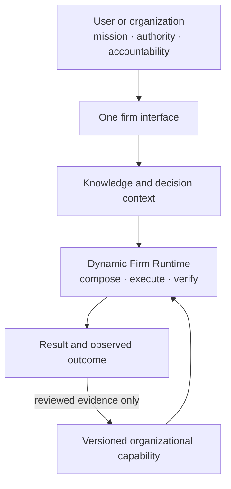

# Noruct product concepts and design

> **Role:** Product-document guide, not a research-paper index.
> [Full document map](../README.md) · [Research and literature](../literature/README.md) · [한국어 번역](../ko/README.md)
> **Canonical language for product documents:** English. Research documents are Korean originals.

## Abstract

Noruct is not a collection of disposable agents. It is a concept for a persistent firm runtime: a system that turns a user's goals, knowledge, decisions, and execution authority into governed work while retaining only the organizational capability justified by evidence. The series explains a product thesis, not an implementation manual or a claim that every optional capability is active in every environment.

## Central thesis

> **Workflows are temporary. Organizational capability compounds.**

The thesis has three parts. A user should not need to draw an agent tree before receiving useful work. A runtime should not mistake a temporary task plan for durable organizational knowledge. And no amount of model capability gives a system the right to own the user's values, irreversible authority, or accountability.

Its operating consequence is a **minimum sufficient organization**: direct or strong solo execution remains the
baseline when added value is unknown, while every additional Employee, execution instance, Manager step, or reviewer
must name its material contribution and integration boundary. The result should end in a short, reviewable delivery,
not require a person to reconstruct the conclusion from raw logs.

## How to read this series

The documents move from purpose to operating model, then from execution to knowledge, control, and optional networked reuse. They intentionally distinguish a **claim** (what the concept proposes), a **mechanism** (how the concept would preserve that claim), and a **boundary** (what the mechanism must not be mistaken for).

Choose one of three groups. Numbering remains a stable identifier; it does not turn these guides into research papers.

### Concepts: purpose and principles

| ID | Guide | Read it for |
| --- | --- | --- |
| 00 | [North Star](00-north-star.md) | Purpose, persistence and human authority. |
| 02 | [Persistent Employee](02-persistent-employee.md) | Persistent capability, assignments and bounded state. |
| 04 | [Graph & Firm Engineering](04-graph-and-firm-engineering.md) | Dependencies, artifact flow and the cost of structure. |
| 09 | [Organization as Decision Architecture](09-organization-as-decision-architecture.md) | Minimum sufficient organization and reviewable delivery. |

### Design: components and operating boundaries

| ID | Guide | Read it for |
| --- | --- | --- |
| 01 | [Dynamic Firm Runtime](01-dynamic-firm-runtime.md) | Company, Manager, Kernel, Job and execution lifecycles. |
| 03 | [Knowledge, Intent & Firm](03-knowledge-intent-firm.md) | Separation of knowledge, direction and execution authority. |
| 05 | [Governed Evolution & User Graphs](05-governed-evolution-and-user-graphs.md) | Blueprints, controlled change and learning. |
| 06 | [Epistemic Control, Oracle & Outcome](06-epistemic-control-and-outcome.md) | Evidence, uncertainty and outcome criteria. |
| 07 | [Network Engineering](07-network-engineering.md) | Optional capability exchange without remote authority. |
| 10 | [Model Intelligence and Multi-Provider Orchestration](10-model-intelligence-and-multi-provider-orchestration.md) | Shared priors, local evidence, frozen routes and data egress. |

### Scope: how to interpret the claims

| ID | Guide | Read it for |
| --- | --- | --- |
| 08 | [Development Scope & Non-Claims](08-current-development-status.md) | Public boundaries, not a current implementation inventory or release report. |

**Short path:** 00 → 02 → 04 → 09. **Design path:** 01 → 03 → 05 → 06, then 07 or 10 for those topics. Check 08 when interpreting implementation or availability claims. The old numerical reading sequence remains available through each guide's navigation.

For the academic argument, use the separate [research manuscript](../literature/organization_governance_manuscript.md). For planned evaluation, use the [experiment path](../README.md#experiments).

## Public-document boundary

This repository publishes product concepts, operating boundaries, and architectural principles. It does not publish customer data, private development records, internal operational configuration, security-sensitive implementation detail, or a promise of autonomous authority.

The [scope guide](08-current-development-status.md) defines non-claims, not a current implementation inventory.
Guides 01 and 10 contain development statements, but this public collection does not provide their underlying private evaluation records. Concept and design descriptions do not establish general availability or commercial qualification.
