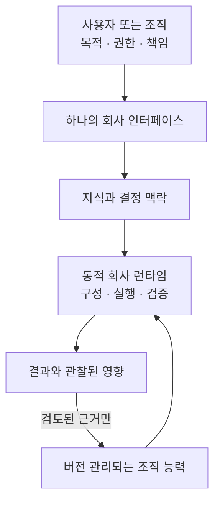

# Noruct 제품 개념·설계 안내

> **문서 역할:** 제품 문서 안내이며 연구논문 목차가 아닙니다.
> [전체 문서 지도](../README.md) · [연구·문헌 안내](../literature/README.md) · [English](../en/README.md)
> 제품 개념·설계 문서는 영문이 정본이며 이 문서는 한국어 번역본입니다. 연구자료는 별도의 한국어 원문입니다.

## 초록

Noruct의 공개 문서는 제품이 무엇을 목표로 하고, 어떤 권한 경계와 운영 원칙을 지키는지 설명합니다. Noruct는
사용자의 목표·지식·결정·실행 권한을 하나의 지속되는 회사 운영 구조로 연결하되, 근거로 정당화된 조직 능력만
다음 작업에 남기려는 개념입니다. 이 문서는 구현 설명서나 모든 선택 기능의 제공 약속이 아닙니다.

## 중심 명제

> **실행 흐름은 임시이고, 조직 능력은 누적된다.**

사용자는 작업마다 에이전트 구조를 설계하지 않아도 됩니다. 반대로 한 번의 작업 구조가 회사의 영구 규칙이 되어서도
안 됩니다. 그리고 어떤 모델도 사용자의 가치, 비가역적 권한, 책임을 자동으로 소유할 수 없습니다.

이 명제의 운영 결과는 **최소 충분 조직**입니다. 추가 가치를 모르면 direct 또는 strong solo가 baseline이며, 추가
Employee·execution instance·Manager 단계·reviewer는 각각 실질 기여와 통합 경계를 설명해야 합니다. 결과는 사람이
raw log에서 결론을 재구성하게 하지 않고 짧고 검토 가능한 전달물로 끝나야 합니다.

## 읽는 방법

문서는 목적에서 시작해 실행 구조, 직원, 지식과 결정, 그래프, 진화, 인식 통제, 선택적 네트워크 순서로 전개됩니다.
각 문서는 세 가지를 구분합니다. **명제**는 Noruct가 제안하는 바이고, **작동 원리**는 그 명제를 지키는 방식이며,
**경계**는 그 원리를 무엇으로 오해하면 안 되는지를 뜻합니다.

아래 세 묶음에서 목적에 맞는 문서를 고릅니다. 번호는 기존 문서 식별자이며 연구논문의 장 번호가 아닙니다.

### 개념: 목적과 원칙

| ID | 문서 | 읽는 목적 |
| --- | --- | --- |
| 00 | [지향점](00-north-star.md) | 목표·지속성·인간 권한의 기준. |
| 02 | [지속 직원](02-persistent-employee.md) | 지속 능력, 할당과 제한된 개인 상태. |
| 04 | [그래프와 회사 공학](04-graph-and-firm-engineering.md) | 의존성, 산출물 흐름과 구조의 비용. |
| 09 | [조직은 직책이 아니라 의사결정 구조다](09-organization-as-decision-architecture.md) | 최소 충분 조직과 검토 가능한 전달. |

### 설계: 구성요소와 운영 경계

| ID | 문서 | 읽는 목적 |
| --- | --- | --- |
| 01 | [동적 회사 런타임](01-dynamic-firm-runtime.md) | Company·Manager·Kernel·Job과 실행 수명주기. |
| 03 | [지식·의도·회사](03-knowledge-intent-firm.md) | 지식·방향·실행 권한의 구분. |
| 05 | [통제된 진화와 사용자 그래프](05-governed-evolution-and-user-graphs.md) | Blueprint, 통제된 변경과 학습. |
| 06 | [인식 통제·판정 기준·결과](06-epistemic-control-and-outcome.md) | 근거·불확실성·성공 판정. |
| 07 | [네트워크 공학](07-network-engineering.md) | 원격 권한을 만들지 않는 선택적 능력 교환. |
| 10 | [Model Intelligence와 다중 Provider 오케스트레이션](10-model-intelligence-and-multi-provider-orchestration.md) | 공유 prior, 로컬 evidence, route 동결과 정보 반출. |

### 공개 범위: 주장을 읽는 기준

| ID | 문서 | 읽는 목적 |
| --- | --- | --- |
| 08 | [개발 범위와 비주장](08-current-development-status.md) | 공개 주장의 경계. 최신 구현 현황표나 릴리스 보고서가 아님. |

**짧은 경로:** 00 → 02 → 04 → 09. **설계 경로:** 01 → 03 → 05 → 06, 이후 관심 주제에 따라 07·10. 구현·제공 여부를 해석할 때 08의 경계를 확인합니다. 기존 번호순 경로는 각 본문의 이전·다음 링크로 유지합니다.

학술 논증은 별도의 [연구논문](../literature/organization_governance_manuscript.md)을, 검증 준비는 [실험 경로](../README.md#experiments)를 읽습니다.

## 공개 문서의 경계

이 문서는 제품 방향과 사용자에게 약속하는 동작 원칙을 설명합니다. source intake, runtime implementation,
보안 운영 세부, 벤치마크, 고객 데이터와 개발 이력은 포함하지 않습니다.

영문판과 번역판의 표현이 다를 경우 영문판이 정본입니다.

[개발 범위와 비주장](08-current-development-status.md)은 비주장을 설명하며 최신 구현 현황표가 아닙니다.
01·10에는 개발 진술이 포함되어 있지만 이 공개 묶음은 그 바탕인 비공개 평가 기록을 제공하지 않습니다.
개념·설계에 등장한다고 해서 해당 기능의 일반 제공이나 상용 검증이 입증되는 것은 아닙니다.
